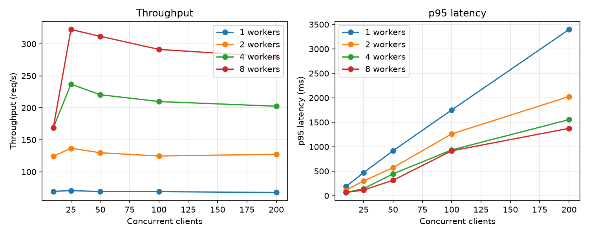

[](https://github.com/yangpings/ehr-asof/actions/workflows/ci.yml)
# ehr-asof

**Keywords:** EHR · MIMIC-IV · temporal leakage · point-in-time correctness · clinical prediction · AUROC · bootstrap confidence intervals

**Skills:** Python · pandas · NumPy · scikit-learn · SQL · PostgreSQL · SQLAlchemy 2.0 · FastAPI · Pydantic · Docker / Docker Compose · GitHub Actions CI · uv packaging · pytest · Hypothesis (property-based testing) · mypy (strict) · ruff · cProfile profiling · load testing (asyncio + httpx, multi-process) · model serving (scikit-learn pipelines) · REST API design (batch endpoints, caching) · Prometheus metrics

Point-in-time (as-of) features for EHR data, and a measurement of how much EHR prediction models rely on information that wasn't available at prediction time.

## Description

EHR tables give most events a clinical time, such as when a blood sample was drawn (`charttime`), but the hospital system often learned the result later (`storetime`). Diagnosis codes carry no time at all, because they are assigned after discharge. A model trained on "everything charted before 24 h" can therefore use results and codes that did not yet exist at 24 h. It looks excellent in a paper and fails silently in deployment. `ehr-asof` gives every event two clocks, builds features under either one, and measures the difference.

## Objective

1. Build a tested method for point-in-time-correct EHR features.
2. Measure how much temporal leakage inflates reported model performance, and what a hospital would get if it deployed the leaky model.

## Hypotheses

- **H1.** Features built on clinical time (naive) contain information that was not available at the prediction time.
- **H2.** Leakage inflates reported AUROC only for outcomes that the leaked information predicts (in-hospital mortality), not for others (length of stay).
- **H3.** A model trained on naive features performs worse when deployed on what is actually available than a model trained honestly.
- **H4.** The earlier the prediction time, the larger the inflation.

## Samples

| Dataset | Access | Size | Role |
| --- | --- | --- | --- |
| Synthetic, MIMIC-shaped (`ehr-asof synth`, seed 0) | Generated | 2,000 patients, 2,737 admissions | Known-answer validation: reporting delays and discharge-time codes are planted |
| MIMIC-IV Clinical Database Demo v2.2 | Open (ODbL) | 100 patients, 275 admissions, 79,307 inpatient lab results, 4,506 diagnosis codes | End-to-end run on real EHR data |

The demo shares the full MIMIC-IV schema, so the same code runs on full MIMIC-IV (credentialed) unchanged.
## Methods

- **Two clocks per event.** Every lab result and diagnosis code carries `event_time` (when it happened) and `available_time` (when a system could know it: `storetime` for labs, discharge for diagnosis codes).
- **Two feature modes, one function.** *Naive* features keep events with `event_time <= cutoff`; *as-of* features keep events with `available_time <= cutoff`. The same code builds features for the experiment and the HTTP service.
- **Three scores on the same test patients.** *Reported* (naive model, naive features), *honest* (as-of model, as-of features), *deployed* (naive model, as-of features); logistic regression, patient-level split, paired patient-level bootstrap (1,000 resamples).
- **Correctness by property tests.** Hypothesis checks on hundreds of random event sets that as-of features never use a not-yet-available event.
- **Service.** FastAPI + Postgres in Docker Compose: features, timelines, risk scores, batch features, delay reports and Prometheus metrics; load-tested at 1–8 workers with failure handling (fast 503s, readiness and liveness probes).

Full methods: [docs/methods.md](docs/methods.md).

## Results

**Synthetic data with a planted leak** (2,000 patients; test n = 802; 24 h cutoff; AUROC with 95% patient-level bootstrap intervals):

| Outcome | Reported | Honest | Deployed | Reported − honest | Reported − deployed |
| --- | --- | --- | --- | --- | --- |
| In-hospital mortality (8.4%) | 0.996 [0.988, 1.000] | 0.884 [0.840, 0.923] | 0.857 [0.814, 0.899] | +0.112 [0.073, 0.155] | +0.139 [0.097, 0.184] |
| Length of stay > 7 days (20.1%) | 0.684 [0.640, 0.729] | 0.682 [0.640, 0.727] | 0.683 [0.640, 0.728] | +0.002 [−0.012, 0.015] | +0.001 [−0.013, 0.014] |

- **Leakage inflates only the outcome the leaked information predicts,** and the gap grows at earlier cutoffs: reported − honest is 0.15 at 6 h and 0.04 at 48 h. Shipping the leaky model does worse than training honestly (0.857 vs 0.884).
- **On the real MIMIC-IV demo** (100 patients), lab results arrive hours after they are drawn (manual smear reads: median 2.8 h, p90 19 h) and diagnosis codes days after admission. Length of stay showed inflation in 9 of 10 random splits (mean +0.053); with 4 deaths in the test set, mortality is uninformative at this size.
- **The service scales and fails cleanly.** Peak throughput 71 / 137 / 237 / 323 req/s on 1 / 2 / 4 / 8 workers with 0 errors; batches of 20 serve 3,680 admissions/s; the limit is the API's CPU-bound feature build, not Postgres. Under overload it now answers 503 in 2 s instead of failing after 30 s, and readiness fails in 1.03 s when the database is down.



Every table, the service and scaling measurements, the live endpoint examples and the full discussion: [docs/results.md](docs/results.md).

**Strengths.** Correctness proven by property tests rather than examples; known-answer validation; paired patient-level bootstrap with a patient-level split; the same feature code in the experiment and the service (no training–serving skew); reproducible from open data, a lock file and CI on Python 3.11–3.13.

## Limitations

- **No real-world effect size.** The demo has 100 patients; its AUROCs have wide intervals and are not evidence about the size of the effect in practice.
- **One small split on the demo.** The demo results rest on a single train/test split with 59 test admissions (4 deaths) and 315 features fitted on 186 training admissions; the bootstrap reflects test-set sampling only; across 10 random splits the length-of-stay gap ranged from −0.034 to +0.155.
- **Synthetic effects are planted.** Their size reflects the generator's assumptions, not real patients.
- **`storetime` is a proxy** for when a clinician or a model's data feed actually saw a result; real feeds may lag further.
- **Availability rules are assumptions** (diagnoses known at discharge; labs without `storetime` fall back to `charttime`) and should be checked by a clinician for each site.
- **Scaling was measured on one machine.** The service, Postgres and the load generator shared one Windows laptop through Docker Desktop, with 500 synthetic patients; the first sweep's single-process generator capped results at about 140 req/s (re-measured with 4 processes). Absolute numbers will differ on a server, and the sublinear scaling past 2 workers (CPU-bound feature building, likely thread oversubscription) has a likely fix that is not yet tested.
- **Scope.** Labs and diagnoses only (no vitals, notes or medications); one model family; one hospital system.

## Trial and error

What went wrong while building this, and what changed as a result. Four that shaped the project:

| Problem | Cause | Fix and lesson |
| --- | --- | --- |
| Feature-level leakage was identical for both outcomes (87.4% of admissions) but inflated only mortality AUROC | Leaked discharge codes predict death, not stay length | Inflation is reported per task. Lesson: leakage has to be measured per outcome, not counted |
| The bootstrap spent 95% of run time in scikit-learn's per-call validation (3,003 AUROC calls) | Library overhead, not computation | A rank-based AUROC verified equal to scikit-learn: 9.3 s → 0.8 s under the profiler, results unchanged |
| Every request failed at 100 concurrent clients on one worker | Each request held its database connection during the pandas work, exhausting the pool | Return the connection before the CPU work; 2 s pool timeout → 503 with `Retry-After`. Re-run: 1,008 requests, 0 errors |
| Throughput stopped rising after 2 workers at about 140 req/s | The single-process load generator was saturated | Two generators reached 220 req/s; with `--procs 4`, 8 workers reached 323 req/s. Lesson: check the measuring tool before the system |

All 26 problems, analysis and engineering: [docs/trial-and-error.md](docs/trial-and-error.md).

## Conclusions

Temporal leakage can make an EHR model look near-perfect on paper while it underperforms an honestly trained model in deployment. `ehr-asof` provides a tested way to build point-in-time-correct features and to report *reported*, *honest* and *deployed* performance side by side. The next step is to estimate the real-world size of the effect on full MIMIC-IV, where the same code runs unchanged.

## Repository layout

| Path | What it does |
| --- | --- |
| `src/ehr_asof/io.py` | Reads MIMIC-IV tables (demo layout or flat CSVs) |
| `src/ehr_asof/events.py` | One event table with `event_time` and `available_time`; delay report |
| `src/ehr_asof/features.py` | Naive and as-of feature matrices; leakage report |
| `src/ehr_asof/stats.py` | AUROC and the paired patient-level bootstrap |
| `src/ehr_asof/experiment.py` | Cohort, models, reported / honest / deployed |
| `src/ehr_asof/synth.py` | MIMIC-shaped synthetic data with planted delays |
| `src/ehr_asof/cli.py` | `synth`, `delays`, `experiment`, `train`, `load-db`, `serve` |
| `src/ehr_asof/db.py`, `api.py` | Postgres storage and the FastAPI service |
| `src/ehr_asof/model.py` | Risk model served by `/risk` (trained on synthetic data by `ehr-asof train`) |
| `src/ehr_asof/metrics.py` | Prometheus metrics, multi-worker aware |
| `tests/` | Unit, property-based (Hypothesis), API and CLI tests |
| `notes/` | SQL exploration of the MIMIC-IV demo |
| `scripts/` | Load test, scaling sweep (`scaling.py`) and its table and plot (`scaling_report.py`) |
| `results/` | Scaling sweep results (JSON lines): before and after the pool fix, multi-process, batch |
| `docs/` | Full methods, results and trial and error; outage drill write-up; scaling plots |

## Reproduce

```bash
uv sync
uv run ehr-asof synth --out data/synth --patients 2000 --seed 0
uv run ehr-asof delays --data data/synth
uv run ehr-asof experiment --data data/synth --outcome mortality --out results/mortality.json
uv run ehr-asof experiment --data path/to/mimic-iv-demo --outcome mortality
```

Service and scaling check (Docker; the API listens on host port 8765):

```bash
docker compose up -d --build
WORKERS=2 docker compose up -d --no-deps api      # PowerShell: $env:WORKERS=2; docker compose up -d --no-deps api
uv run python scripts/scaling.py --label "2 workers"
uv run python scripts/scaling_report.py
```

Development: `uv run ruff format --check src tests`, `uv run ruff check src tests`, `uv run mypy src` (strict), `uv run pytest`.

## Citations

- Johnson, A., Bulgarelli, L., Pollard, T., Horng, S., Celi, L. A., & Mark, R. (2023). MIMIC-IV Clinical Database Demo (version 2.2). PhysioNet. RRID:SCR_007345. https://doi.org/10.13026/dp1f-ex47
- Johnson, A. E. W., Bulgarelli, L., Shen, L., et al. (2023). MIMIC-IV, a freely accessible electronic health record dataset. *Scientific Data*, 10, 1. https://doi.org/10.1038/s41597-022-01899-x
- Pollard, T., Moody, B. E., Lehman, L., Gow, B., Fernandes, C., Xie, C., Johnson, A., Mark, R. G., & Heldt, T. (2026). PhysioNet as a global platform for biomedical research. *Nature Health*. https://doi.org/10.1038/s44360-026-00096-z

## License

Code: MIT. The MIMIC-IV demo data is distributed by PhysioNet under the Open Data Commons Open Database License v1.0 and is not included in this repository.