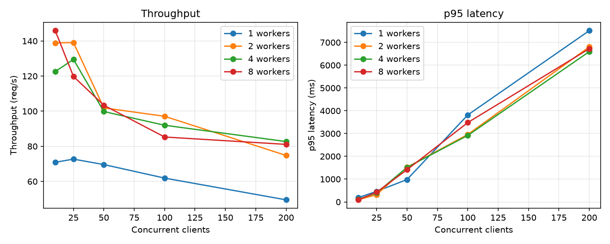

# Results and discussion

Full results for [ehr-asof](../README.md): every table, the service and scaling measurements, the MIMIC-IV demo and the discussion. All numbers on synthetic data are known-answer validation; the demo shows the method runs on real EHR data.

## Synthetic data (known answer)

1,935 training and 802 test admissions; 23 features; all 1,000 bootstrap resamples valid. 87.4% of test admissions had at least one naive feature value that wasn't available at 24 h (13.3% of all feature cells, and 61% of lab-count cells).

| Outcome (test n = 802) | Reported | Honest | Deployed | Reported − honest | Reported − deployed |
| --- | --- | --- | --- | --- | --- |
| In-hospital mortality (8.4%) | 0.996 [0.988, 1.000] | 0.884 [0.840, 0.923] | 0.857 [0.814, 0.899] | +0.112 [0.073, 0.155] | +0.139 [0.097, 0.184] |
| Length of stay > 7 days (20.1%) | 0.684 [0.640, 0.729] | 0.682 [0.640, 0.727] | 0.683 [0.640, 0.728] | +0.002 [−0.012, 0.015] | +0.001 [−0.013, 0.014] |

| Mortality, cutoff | Reported | Honest | Deployed | Reported − honest | Reported − deployed |
| --- | --- | --- | --- | --- | --- |
| 6 h | 0.991 | 0.843 | 0.772 | 0.148 | 0.219 |
| 12 h | 0.991 | 0.851 | 0.823 | 0.140 | 0.168 |
| 24 h | 0.996 | 0.884 | 0.857 | 0.112 | 0.139 |
| 48 h | 0.997 | 0.959 | 0.952 | 0.038 | 0.045 |

All property tests pass (200 random cases each). When the as-of filter is deliberately switched to clinical time, both fail, and Hypothesis shrinks the failure to a single lab result drawn at the cutoff and stored one minute later: the tests catch even a one-minute leak.

## Service

| Endpoint | Returns |
| --- | --- |
| `GET /admissions/{id}/features?as_of=&mode=` | Features as of a timestamp, naive or as-of |
| `GET /admissions/{id}/timeline?as_of=&status=` | Every event on both clocks, labelled known / leaked / future |
| `GET /admissions/{id}/risk?as_of=` | Mortality risk: reported, honest and deployed, side by side |
| `POST /features/batch` | Features for up to 200 admissions, each at its own as_of, in one request |
| `GET /delays?source=&limit=` | Reporting delay per code (median, p90, max), slowest first |
| `GET /model` | The served risk model: outcome, horizon, training size and time |
| `GET /metrics` | Prometheus metrics, summed across workers |
| `GET /health/live, /health/ready` | Liveness (never touches the database) and readiness (503 when it's down) |

The API returns an admission's features as of any timestamp. For synthetic admission 20000001: as of 2150-01-01 (before admission) it uses 0 events; as of 2150-12-31 (after discharge) it uses 197 events.

**The leak, in one request.** The same admission, the same moment (24 hours after admission, 2150-07-25 20:37), in both modes:

| | As-of (what a deployed system knows) | Naive (clinical time) |
| --- | --- | --- |
| Events used | 12 | 16 |
| Lab results | 12 | 13: adds HbA1c (6.82%), drawn before 24 h but not yet resulted |
| Diagnosis flags | none | cardiac arrest (I469), septic shock (R6521), palliative care (Z515) |

At 24 hours the naive pipeline already "knows" that this patient will be coded for cardiac arrest and palliative care, codes that were only assigned at discharge. This is the information that inflates reported mortality AUROC.

| Load test (closed loop, 20 clients, 15 s, SQLite, 1 worker) | Result |
| --- | --- |
| Requests (errors) | 1,696 (0) |
| Throughput | 112.3 req/s |
| Latency p50 / p95 | 178 ms / 224 ms |
| Little's law check, L = λW | 112.3 × 0.178 s = 19.9 in flight (20 clients) |

The Little's law check confirms the measurement is internally consistent: with 20 clients always waiting on a response, throughput × latency should equal 20.

**Re-measured with a multi-process generator** (4 load-generator processes, same stack and levels; throughput in req/s, p95 in ms in brackets; 0 errors at every level). Plot: `docs/scaling_procs4.png`.

| Multi-process generator: workers | 10 clients | 25 | 50 | 100 | 200 |
| --- | --- | --- | --- | --- | --- |
| 1 | 69.5 (188) | 70.8 (472) | 69.2 (918) | 69.1 (1,752) | 67.8 (3,397) |
| 2 | 124.4 (112) | 136.9 (302) | 129.9 (572) | 124.8 (1,263) | 127.5 (2,026) |
| 4 | 168.8 (65) | 237.1 (143) | 220.6 (445) | 209.9 (935) | 202.6 (1,555) |
| 8 | 169.1 (65) | 322.5 (116) | 311.9 (315) | 291.4 (917) | 279.6 (1,376) |

With the generator no longer the limit, throughput rises with workers: peak 70.8, 136.9, 237.1 and 322.5 req/s for 1, 2, 4 and 8 workers, a speedup of 1.9×, 3.3× and 4.6× over one worker. Scaling is sublinear past 2 workers (57% efficiency at 8). One worker serves about 70 req/s however many clients wait, about 14 ms of CPU per request. At 10 clients, 4 and 8 workers give the same 169 req/s because the clients, not the server, are the limit: 10 clients waiting about 58 ms each cannot send more (Little's law). Throughput now stays within 13% of its peak at 200 clients, so most of the earlier fall with rising clients was the generator.

**Batching** (8 workers, `POST /features/batch` with 20 admissions per request, 4 generator processes):

| Clients | Requests/s | Admissions/s | p95 (ms) |
| --- | --- | --- | --- |
| 10 | 152.7 | 3,055 | 114 |
| 25 | 184.0 | 3,680 | 308 |
| 50 | 163.2 | 3,263 | 581 |

At 25 clients, batches of 20 served 3,680 admissions/s against 322.5 single-admission req/s on the same 8 workers: 11.4× more admissions per second, at a p50 of 96 ms per batch. The fixed per-request costs (HTTP, a database connection, pandas setup) are paid once per batch instead of once per admission.

## Live endpoints (Docker, synthetic data)

Admission 20000001, 24 hours after admission (2150-07-23 17:09), on the Docker stack with the risk model trained by the loader (683 admissions, 20 features):

| Endpoint | Result |
| --- | --- |
| `/timeline` | 13 known, 3 leaked, 5 future. Leaked: hypertension (I10) and pneumonia (J189) codes, dated at admission but available at discharge 39.5 h later; HbA1c drawn 20 min after admission, resulted 38.7 h later |
| `/risk` | reported 0.0002, honest 0.021, deployed 0.0000 |
| `/features/batch` | 20000001: 13 events (matches the timeline's known count); 20000002: 71; admission 1 returned under `missing` |
| `/delays` | Diagnosis codes median 110–117 h; HbA1c 31.4 h (p90 82 h); troponin 3.0 h; creatinine, sodium, potassium 1.5 h |
| `/metrics` | Request counts per route template and status, summed across both workers |

The delay report recovers the delays planted in the synthetic generator (HbA1c 30 h, troponin 3 h, chemistry 1.5 h), so the service gives the known answer. The risk scores show the mechanism on one admission: the leaky model is near-certain the patient survives because it already sees which diagnosis codes the stay will end with; given only what was known at 24 h, the same model goes to 0.0000, while the as-of model gives 0.021. One admission illustrates the mechanism; the evidence for its size is the synthetic experiment above.

## Containers and failure drill

`docker compose up --build` starts Postgres 16, a one-shot loader (exits 0 after loading), and the API (non-root user, health check on `/health/live`). The API image is 740 MB on disk (168 MB compressed), mostly the scientific Python stack.

| Outage drill (database stopped under a running API) | `/health/live` | `/health/ready` |
| --- | --- | --- |
| Normal | 200 | 200 |
| `docker compose stop db` (first drill) | 200 (0.55 ms) | 503 with `Retry-After: 5`, after 4.0 s |
| `docker compose stop db` (re-run with the 1 s readiness timeout, 2 workers) | 200 (2.9 ms) | 503 with `Retry-After: 5`, after 1.03 s |
| `docker compose start db` (no API restart) | 200 | 200 (6.3 ms) |

The API degraded cleanly and recovered on its own; the request ID on the 503 response matches the server's JSON log line. The full write-up is in [`docs/outage-drill.md`](outage-drill.md).

## Scaling

Closed-loop sweep against the Docker stack (Postgres 16, 500 synthetic patients, 683 admissions), 15 s per concurrency level, on a Windows laptop with Docker Desktop. Each client sends a request, waits for the answer, then sends the next.

| Before the fix, 1 worker: clients | Requests | Errors | Throughput (req/s) | p50 (ms) | p95 (ms) |
| --- | --- | --- | --- | --- | --- |
| 10 | 1,123 | 0 | 74.4 | 135 | 178 |
| 25 | 1,081 | 0 | 70.8 | 343 | 498 |
| 50 | 1,051 | 0 | 67.2 | 737 | 1,203 |
| 100 | 0 | 100 | 0 | – | – |
| 200 | 0 | 200 | 0 | – | – |

One worker was already saturated at 10 clients: throughput stayed near 70 req/s, and each extra client only added queueing (p50 grew in proportion; Little's law gives 10.0, 24.8 and 49.0 requests in flight). At 100 clients every request failed because the database connection pool ran out (`QueuePool limit of size 5 overflow 10 reached, connection timed out, timeout 30.00`). The server log also shows feature requests finishing after 60 s, long after the load generator's 30 s client timeout: the server kept working for clients that had already given up. Under the same load, `/health/live` took 40–53 s to answer; after making it `async def`, it answered in 3–5 ms (5 probes, all 200) while 2 workers served 200 clients.

Throughput in req/s, with p95 latency in ms in brackets; 0 errors unless shown.

| After the fix: workers | 10 clients | 25 | 50 | 100 | 200 |
| --- | --- | --- | --- | --- | --- |
| 1 | 70.9 (189) | 72.7 (464) | 69.6 (982) | 61.9 (3,817) | 49.5 (7,518), 2 errors |
| 2 | 138.9 (94) | 139.1 (319) | 101.9 (1,522) | 97.1 (2,960) | 74.8 (6,803) |
| 4 | 122.6 (114) | 129.5 (397) | 99.8 (1,515) | 92.0 (2,918) | 82.7 (6,598) |
| 8 | 145.9 (90) | 119.8 (429) | 103.4 (1,412) | 85.3 (3,483) | 81.1 (6,726) |

The fix didn't make one worker faster (about 71 req/s, the same as before); it changed how overload ends. At 100 clients one worker now serves 1,008 requests with 0 errors instead of failing every one, and at 200 clients 2 of 973 requests fail. A second worker doubles throughput to about 139 req/s. Beyond 2 workers the measured throughput stays flat (146 req/s at most), but that ceiling belongs to the load generator, not the service (below).

A single 1-second `docker stats` snapshot per worker count (so the CPU readings are rough):

| Workers | `api` CPU | `db` CPU | `api` memory |
| --- | --- | --- | --- |
| 1 | 115% | 17% | 103 MiB |
| 2 | 225% | 17% | 234 MiB |
| 4 | 179% | 12% | 438 MiB |
| 8 | 156% | 13% | 801 MiB |

The database is never the bottleneck (12–17% CPU). The API container never used more than about 2.3 cores, even with 8 workers, so the workers were waiting on something outside them. Memory grows about 100 MiB per worker, because each worker is a separate Python process. **The bottleneck was the load generator.** Docker had 24 CPUs, so the CPU count wasn't the limit. Two load generators with 25 clients each, run at the same time against 8 workers, got 109.2 + 110.9 = 220.1 req/s with 0 errors, while one generator with 50 clients had got 103.4 req/s. The single Python process sending the requests saturated at about 140 req/s, so the 4- and 8-worker numbers above were lower bounds; the re-measurement below gives the real ceiling. The fall in throughput as clients rise is most likely the generator too, spending more of its time managing hundreds of connections.

## Computational performance

| | Experiment wall time (mortality, 1,000 resamples) | AUROC calls | Share of profiled time in AUROC |
| --- | --- | --- | --- |
| scikit-learn `roc_auc_score` | 6.1 s | 3,003 | 95% (8.8 of 9.3 s) |
| Rank-based (Mann–Whitney) AUROC | 2.7 s | 3,003 | 41% (0.33 of 0.82 s) |

Under the profiler the whole experiment went from 9.3 s to 0.8 s, and the AUROC calls from 8.8 s to 0.33 s (about 27× faster). Most of the remaining wall time is Python start-up and imports. The full test suite, which includes a 120-repetition bootstrap coverage test, now runs in under 30 seconds.

Point estimates and all bootstrap intervals are unchanged: the largest difference across every estimate and interval bound is 1.9 × 10⁻¹⁶ (floating-point rounding), so the speedup does not alter any result.

## MIMIC-IV demo (real data)

**Data flow.** The demo has 107,727 lab results; 28,420 (26%) are outpatient labs with no admission and are dropped, leaving 79,307 inpatient results for 275 admissions.

**Lab results arrive late.** Delay from draw (`charttime`) to result (`storetime`), inpatient lab types with at least 50 results:

| Lab | n | Median (h) | p90 (h) |
| --- | --- | --- | --- |
| Blasts (smear) | 57 | 2.80 | 19.03 |
| Schistocytes (smear) | 70 | 2.66 | 5.10 |
| Microcytes (smear) | 244 | 2.47 | 4.79 |
| Anisocytosis (smear) | 249 | 2.43 | 4.77 |
| Platelet smear | 264 | 2.28 | 4.23 |

The slowest common labs are manual blood-smear reads: a model predicting at 24 h from clinical time would use smear results drawn in the previous 2–5 hours (up to 19 h for blasts) that were not yet available. The same delays were computed independently in SQL (Postgres) and in Python (`ehr-asof delays`) and agree exactly.

**Diagnosis codes leak the most.** Codes become available at discharge, a median of 100–136 hours after admission for the most common codes (e.g. hypertension, hyperlipidemia), yet the common shortcut treats them as known at admission.

**The fallback rule is rarely needed.** 0.92% of all lab rows, and 0.44% of inpatient lab rows, have no `storetime`.

**AUROC on the demo** (24 h cutoff; 186 training and 59 test admissions; 315 features; 1,000 patient-level bootstrap resamples):

| Outcome (test prevalence) | Reported | Honest | Deployed | Reported − honest | Reported − deployed | Valid resamples |
| --- | --- | --- | --- | --- | --- | --- |
| In-hospital mortality (6.8%, 4 deaths) | 0.768 [0.454, 0.981] | 0.668 [0.314, 1.000] | 0.468 [0.162, 0.979] | +0.100 [−0.293, 0.576] | +0.300 [−0.017, 0.719] | 983 |
| Length of stay > 7 days (40.7%) | 0.717 [0.598, 0.835] | 0.562 [0.442, 0.683] | 0.520 [0.389, 0.657] | +0.155 [0.053, 0.236] | +0.196 [0.083, 0.287] | 1,000 |

In the demo test set, 93.2% of admissions had at least one feature value that wasn't available at 24 h (2.9% of feature cells; 17% of lab-count cells).

- **Mortality is uninformative at this size.** With 4 deaths among 59 test admissions, every interval spans most of the 0–1 range and 17 resamples had no deaths at all.
- **Length of stay shows inflation on real data, unlike the synthetic data.** The reported − honest gap is +0.155 with an interval excluding 0, and the deployed model is close to chance (0.520). In the synthetic generator, discharge codes were tied to death but not to stay length; in real records, longer stays plausibly accumulate more diagnosis codes and more labs, so the leaked information also predicts length of stay. Repeating the experiment over 10 random patient splits (seeds 0–9, 200 resamples each) gave reported − honest gaps of 0.155, 0.049, −0.034, 0.014, 0.048, 0.019, 0.086, 0.063, 0.010 and 0.124: positive in 9 of 10 splits, mean +0.053. The direction is consistent, but the first split (+0.155) was at the high end, so the size is uncertain. This is a hypothesis to test on full MIMIC-IV, not a finding.

## Discussion

On synthetic data, where the leak is planted and the answer is known, all four hypotheses hold. Naive features leaked for most admissions (H1). Mortality AUROC was inflated by 0.11 while length of stay was unaffected, even though both tasks used the same leaky features (87.4% of admissions affected): the leaked discharge codes (cardiac arrest, palliative care) predict death but not stay length (H2). Feature-level leakage alone doesn't tell you how much a result is inflated; it has to be measured per task. Shipping the naive model was worse than training honestly: 0.857 vs 0.884 (H3). The gap grew from 0.04 at 48 h to 0.15 at 6 h (H4). The practical lesson is that leakage is task-specific and has to be measured, not assumed, and that the cost of ignoring it is paid at deployment, not in the paper.

On the real MIMIC-IV demo, the picture changed in an instructive way. Length of stay, which showed no inflation on synthetic data, was inflated on the demo: +0.155 [0.053, 0.236] on the first split, and positive in 9 of 10 random splits (mean +0.053); the naive model was close to chance once deployed on what was actually available (0.520 on the first split). Hypothesis H2 as stated (inflation for mortality but not length of stay) held on synthetic data but not on real data: which outcomes are affected depends on how the leaked information relates to each outcome in real records, which a synthetic generator can only assume. This is the strongest argument for measuring leakage per task on real data rather than reasoning about it.

The method's correctness does not rest on sample size: it is established by property tests and by known-answer synthetic data. The MIMIC-IV demo shows that the pipeline runs on real EHR data and that the leak is real: diagnosis codes become available days after admission, and common lab results arrive hours after they are drawn.

The performance work illustrates a general point for evaluation-heavy research code: the expensive step was not modeling but a small statistic evaluated thousands of times, where a library's per-call overhead outweighed the computation itself. Measuring before optimizing located the cost, and an equivalent closed-form computation, verified against the reference implementation, removed it without changing any result. Resampling-based uncertainty estimates are only practical to run routinely, and in CI, if they are fast.

**Strengths.** Correctness proven by property tests rather than examples; known-answer validation; paired patient-level bootstrap with a patient-level split; the same feature code in the experiment and in the HTTP service (no training–serving skew); reproducible by anyone from open data, a lock file and CI on Python 3.11–3.13; a profiled, verified AUROC that keeps the full bootstrap fast enough to run in tests.
